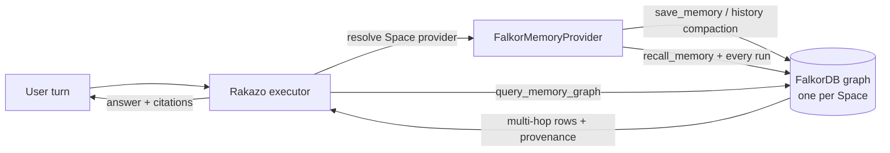

# FalkorDB graph memory

Rakazo bots already keep durable Markdown memory and can optionally use a semantic
memory backend. This integration adds **FalkorDB** as that backend, and makes the graph
do the retrieval, the isolation, and the explanation — not just storage.

- Provider id: `falkordb`
- Port implemented: `SemanticMemoryProvider` (`packages/adapter-kit/src/interfaces.ts`)
- Graph code: `packages/adapters/src/falkordb-graph.ts`
- Provider code: `packages/adapters/src/falkordb-memory-provider.ts`
- Agent tool: `query_memory_graph` (read-only Cypher)
- Settings UI: `apps/web/src/pages/memory-providers/FalkorDBSettingsForm.tsx`



## Why a graph

Three things the flat Markdown store and a vector store cannot do well:

1. **Multi-hop recall.** “What is blocking the Atlas renewal?” lives in one memory, but
   the reason (“SOC 2 evidence missing from billing-api”) lives in another memory that
   shares no words with the question. The shared *entities* connect them.
2. **Tenant and scope boundaries as structure.** Each Space is a separate FalkorDB
   graph, so a bug cannot leak another tenant’s memories through a missing `WHERE`.
3. **Traceable answers.** Recall returns the traversal that produced each memory:
   `direct: acme · 1-hop: billing-api (w=4) · terms 2/3`. The agent can show its work.

## Graph model

One graph per Space: `<namespace>_space_<sha256(spaceId)[:24]>`.

| Node | Properties |
| --- | --- |
| `Space` | `id`, `createdAt`, `updatedAt` |
| `Bot` | `id` |
| `User` | `id` |
| `Memory` | `id`, `text`, `kind` (`durable`/`history`), `scope` (`isolated`/`shared`), `botId`, `userId`, `spaceId`, `createdAt`, `updatedAt`, `generation`, `sourceRunId`, `sourceThreadId`, `expired` |
| `Entity` | `key` (normalized), `name`, `type`, `createdAt`, `lastSeenAt` |
| `Thread` | `id`, `createdAt` |

| Edge | Meaning |
| --- | --- |
| `(:Bot)-[:REMEMBERS]->(:Memory)` | which bot wrote/owns a memory |
| `(:User)-[:SAVED]->(:Memory)` | who asked for it |
| `(:Memory)-[:IN_SPACE]->(:Space)` | tenant anchor |
| `(:Memory)-[:MENTIONS {count}]->(:Entity)` | memory ↔ topic/name/ticket/URL |
| `(:Entity)-[:CO_OCCURS {weight}]-(:Entity)` | learned topic graph, updated on every save |
| `(:Memory)-[:NEXT]->(:Memory)` | episodic chain per bot + scope + kind |
| `(:Memory)-[:SOURCED_FROM]->(:Thread)` | the conversation a decision came from |

`Entity.key` is lowercased, whitespace-collapsed and stripped of wrapping punctuation,
so `Acme Corp.` and `acme corp` meet at the same node.

## Write path

`save` is idempotent. The node id is a SHA-256 of
`spaceId · scope · botId · kind · generation · normalized text`, so a retried run
`MERGE`s the same node instead of duplicating a fact.

1. `MERGE` Space / Bot / User / Memory and their edges.
2. Extract entities offline (no model call, no latency, deterministic):
   URLs, emails, `ABC-123` ids, `@handles`, `#tags`, quoted phrases, capitalised runs,
   camelCase/snake_case/file names, and significant lowercase terms.
3. Upsert `MENTIONS` edges and increment co-occurrence weights between the entities
   of this memory.
4. Link `SOURCED_FROM` to the thread when the executor supplies one.
5. Link `NEXT` after the previous memory for the same bot/scope/kind.

Conversation summaries are stored as `kind: "history"` with their compaction
`generation`; `purgeHistory` (`DETACH DELETE`) removes exactly the generations Rakazo
cleared, including the late-save race the executor already handles.

## Read path

`recall` runs in the provider on every agent turn (when semantic recall is enabled):

1. Extract query entities → seed keys.
2. **Seeds:** memories with `MENTIONS` edges to those keys.
3. **Expansion:** 1..`maxHops` (1–3) over `CO_OCCURS`, weighted by co-occurrence count.
4. **Hop memories:** memories mentioning the discovered entities.
5. **Recent scan (≤200):** lexical fallback for wording the entity extractor missed.
6. **Rank:**

   ```
   score = 0.60 · lexical_overlap
         + 0.28 · min(1, entity_hits / 2)
         + 0.12 · exp(-ageDays / 45)
         + 0.10 · exact_phrase
   ```

   Entity hits are 1.0 for a direct seed and `(1/hop) · min(1, log1p(weight)/log1p(8))`
   for a discovered neighbour. The result is clamped to `[0, 1]`.
7. Drop candidates with no lexical or entity signal, dedupe, sort, cap at `limit`.

Each result carries `id` (for `forget_memory`), `score`, `updatedAt`, `entity`
(`bot:<id>` / `space:<id>`) and the human-readable `provenance` trail.

## Agent surface

Rakazo already exposes these tools when a semantic provider is configured:

- `save_memory` → graph write + entity/co-occurrence update
- `recall_memory` → multi-hop recall with provenance
- `forget_memory` → soft delete (`expired = true`, reason recorded)

FalkorDB additionally enables one tool:

- `query_memory_graph` → read-only Cypher against the Space graph

The tool description ships the schema, so the model can write queries such as:

```cypher
MATCH (b:Bot)-[:REMEMBERS]->(m:Memory)-[:MENTIONS]->(:Entity {key: 'billing-api'})
RETURN b.id AS bot, count(DISTINCT m) AS memories
ORDER BY memories DESC
```

```cypher
MATCH p=(a:Entity {key: 'atlas'})-[*1..4]-(b:Entity {key: 'soc'})
RETURN [n IN nodes(p) | n.key] AS path, length(p) AS hops
ORDER BY hops ASC
LIMIT 5
```

Safety is layered:

1. **Server-side:** the query runs as `GRAPH.RO_QUERY`, which FalkorDB refuses to use
   for writes.
2. **Provider-side:** `assertReadOnlyCypher` rejects `CREATE`, `MERGE`, `DELETE`,
   `SET`, `DROP`, `CALL`, `FOREACH`, multiple statements, and non-`MATCH`/`WITH`/
   `RETURN` starts. String literals and comments are stripped first, so
   `WHERE n.text = 'delete me'` is allowed.
3. **Result-side:** a `LIMIT` is appended when absent and rows are capped (default 50,
   max 100).

## Tenancy and security

- **Separate graph per Space.** Isolation is the storage boundary; scope filters are
  still applied for `isolated` vs `shared` within the Space.
- **Scoped recall.** `isolated` reads only `botId = <this bot>`; `shared` reads shared
  memories for the Space plus this bot’s isolated ones.
- **Expired memories never recall.** `forget` is a soft delete, so the fact stays
  auditable until an operator purges the graph.
- **Private endpoint gating.** `falkordb://localhost`, private IPs, and hostnames that
  resolve to private addresses require the deployment owner — the same policy as
  Serenity and local Supermemory. Classification happens before the credentialed probe.
- **Credentials** are stored through the existing encrypted `SecretStore`, never in
  `settings` and never in the URL. `FalkorDB` URLs with embedded credentials are
  rejected.
- **No cross-Space operations.** The provider only ever selects the graph derived from
  the current `context.spaceId`.

## Setup

### Bundled Compose stack

```bash
docker compose --env-file .env -f infra/compose/docker-compose.yml up --build
```

Then in the app: **Settings → Memory → Provider: FalkorDB**

| Field | Value |
| --- | --- |
| Endpoint | `falkordb://falkordb:6379` |
| Graph namespace | `rakazo` (default) |
| Recall hops | `2` |
| Mode | Recall and write |

The endpoint is private (Docker network), so the deployment owner must be signed in —
this is deliberate.

### Local FalkorDB only

```bash
docker compose -f infra/falkordb/docker-compose.yml up -d
```

Then use `falkordb://localhost:6379` from a local API process’s Memory settings.

### Verify end to end

```bash
# 1. Seed a company scenario and print recall trails + graph queries
FALKORDB_URL=falkordb://localhost:6379 pnpm demo:falkordb

# 2. Run the real-server integration tests
FALKORDB_URL=falkordb://localhost:6379 \
  npx vitest run packages/adapters/src/falkordb-graph.integration.test.ts
```

The provider path is exercised too: the same file builds a real `FalkorMemoryProvider`
and covers `save → recall → queryGraph → purgeHistory`, so the tests hit the exact
entry points the agent tools use.

Verified on 2026-10-18 against FalkorDB 4.16.3 (Redis 7.4.2) with the `falkordb`
npm client 6.8.0. The captured run is in
[`docs/hackathon/demo-output.txt`](hackathon/demo-output.txt).

The unit suite (no server) runs with the normal `pnpm test`:

```bash
npx vitest run \
  packages/adapters/src/falkordb-graph.test.ts \
  packages/adapters/src/falkordb-memory-provider.test.ts \
  packages/adapters/src/memory-provider-factory.test.ts \
  packages/adapters/src/memory-tools.test.ts \
  apps/web/src/pages/memory-providers/falkordb-settings.test.ts
```

## Query cookbook

```cypher
-- who knows about a topic?
MATCH (b:Bot)-[:REMEMBERS]->(m:Memory)-[:MENTIONS]->(e:Entity {key: 'billing-api'})
RETURN b.id AS bot, count(DISTINCT m) AS memories ORDER BY memories DESC

-- what decisions did Priya make, and where did they come from?
MATCH (u:User {id: 'priya'})-[:SAVED]->(m:Memory)-[:SOURCED_FROM]->(t:Thread)
WHERE m.kind = 'durable'
RETURN m.text AS decision, t.id AS thread, m.updatedAt AS at ORDER BY at DESC

-- how are two topics connected?
MATCH p=(a:Entity {key: 'atlas'})-[*1..4]-(b:Entity {key: 'soc'})
RETURN [n IN nodes(p) | n.key] AS path, length(p) AS hops ORDER BY hops ASC LIMIT 5

-- episodic chain around an incident
MATCH (t:Thread {id: 'thread-incident'})<-[:SOURCED_FROM]-(m:Memory)
RETURN m.text AS memory, m.createdAt AS at ORDER BY at ASC

-- latest facts mentioning a topic
MATCH (m:Memory)-[:MENTIONS]->(:Entity {key: 'renewal'})
WHERE m.expired = false
RETURN m.text AS memory, m.scope AS scope, m.botId AS bot ORDER BY m.updatedAt DESC LIMIT 10
```

## Design decisions and limits

- **`falkordb://` is the user-facing scheme.** The official client rewrites any
  `falkor` prefix to `redis`, which turns `falkordb://` into the invalid
  `redisdb://`; the provider translates it to `redis://` (and `rediss://` stays as
  given) right before `FalkorDB.connect`. Verified against the real server.
- **No embedding model required.** Retrieval is lexical + entity-graph. This keeps
  memory writes free and deterministic, and works with any model provider. A vector
  index can be added later as another ranking signal without changing the schema.
- **Entity extraction is heuristic, not LLM-based.** It is fast and testable
  (`extractMemoryEntities`), but it will miss some implicit topics. The recent-memory
  lexical fallback covers part of that gap.
- **Co-occurrence grows with writes.** Memory writes are bounded (8,000 chars) and the
  entity list is capped at 40 per write. Very large deployments should add a periodic
  decay/prune job.
- **`NEXT` is best-effort under concurrency.** Two simultaneous saves for the same bot
  can branch the chain. Recall does not depend on the chain; it is for narrative and
  audits.
- **Memories are never auto-pruned.** `forget_memory` soft-deletes; `purgeHistory`
  hard-deletes cleared conversation summaries. Graph retention is an operator decision.
- **Read-only tool, not arbitrary Cypher.** `query_memory_graph` is intentionally
  scoped to the Space’s memory graph and rejects writes; it is not a general FalkorDB
  console.

## Troubleshooting

| Symptom | Cause / fix |
| --- | --- |
| `FalkorDB at falkordb://… is unreachable (ECONNREFUSED…)` | Wrong host/port, container not running, or API not on the same Docker network. |
| Connect fails with `FORBIDDEN` | Private endpoint configured by a non-owner. Sign in as the deployment owner or use a public host. |
| Connect fails with `WRONGPASS` | Username/password mismatch; credentials are stored separately from settings. |
| Recalls are empty | The bot has no durable memories yet, or `allowWrites` was off so `save_memory` never wrote. Check `MATCH (m:Memory) RETURN count(*)`. |
| `Writes are not allowed in memory graph queries` | `query_memory_graph` only accepts read-only Cypher by design. |
| `CALL db.labels()` rejected | Provider procedures are blocked; use `MATCH (n) RETURN DISTINCT labels(n)` instead. |

## File map

| File | Role |
| --- | --- |
| `packages/adapters/src/falkordb-graph.ts` | Schema, entity extraction, recall scoring, read-only guard |
| `packages/adapters/src/falkordb-memory-provider.ts` | Settings, URL/DNS policy, connection pool, `SemanticMemoryProvider` |
| `packages/adapters/src/falkordb-graph.test.ts` | 31 unit tests (no server) |
| `packages/adapters/src/falkordb-memory-provider.test.ts` | 24 unit tests (provider, pool, policy) |
| `packages/adapters/src/falkordb-graph.integration.test.ts` | 6 real-server tests (`FALKORDB_URL`): graph + provider paths |
| `apps/web/src/pages/memory-providers/FalkorDBSettingsForm.tsx` | Settings form |
| `scripts/falkordb-demo.ts` | Seed + demo script |
| `infra/falkordb/docker-compose.yml` | Standalone FalkorDB |
